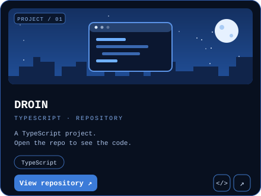

 

---

## ✦ About Me

Hi, I'm **Elliot**. I build things with **TypeScript, HTML and CSS**, from a personal finance API to a Discord music-presence app.

I like turning ideas into small working projects, and I'm learning in public, one commit at a time.

---

## 🛠️ Tech Stack

### Languages & Markup

**Programming:** `TypeScript` · `JavaScript`  
**Markup & styling:** `HTML5` · `CSS3`

### Frameworks, Runtimes & Data

`Bun` · `Hono` · `Node.js` · `Electron` · `PostgreSQL` · `Azure Functions` · `Cosmos DB` · `Bootstrap` · `jQuery`

### Developer Tools

`Git` · `GitHub` · `Docker`

---

## 📂 Featured Projects

<table>
  <tr>
    <td width="50%"></td>
    <td width="50%"></td>
  </tr>
</table>

✦ <b>DROIN</b> — features & technical highlights

 

- Wallets, categories and transactions with search, tags and receipt attachments
- Transfers, monthly budgets, recurring rules and savings goals
- Debts and split bills among friends
- Reports and insights: spending pace, budget alerts, savings rate
- Quick input from text, receipt photos or voice into transaction drafts, with OCR running locally
- Excel, CSV and PDF-ready exports, plus an offline sync change feed and push notifications
- Safe retries with `Idempotency-Key`, and a hand-written OpenAPI spec with Swagger UI

✦ <b>hummie</b> — features & technical highlights

 

- Shows the current YouTube Music track as a Discord "Listening" activity
- Optional synced lyrics from LRCLIB shown on the activity line
- Manifest V3 browser extension talking to a tray-only Electron helper over a local WebSocket
- Pairing needs explicit approval, the helper binds only to `127.0.0.1`, and every message is schema-validated

### More work

| Project | What it is |
|---|---|
| [Pre-Probation-Test](https://github.com/Zoelunels/Pre-Probation-Test) | Digital wedding invitation sliced from a design, using HTML, CSS, Bootstrap 4, jQuery, AOS, Swiper and Fancybox |
| [kitameraki-be-test](https://github.com/Zoelunels/kitameraki-be-test) | Task management REST API on Azure Functions and Cosmos DB with configurable form settings |
| [stamps-tasks](https://github.com/Zoelunels/stamps-tasks) | JavaScript exercises: FizzBuzz and a 5-day Jakarta weather forecast from OpenWeatherMap |

---

## 🐍 Contribution Snake

  <picture>
    <source media="(prefers-color-scheme: dark)" srcset="https://raw.githubusercontent.com/Zoelunels/Zoelunels/output/github-snake-dark.svg"/>
    
  </picture>

---

## ✦ Connect

made by Elliot · [@Zoelunels](https://github.com/Zoelunels)
