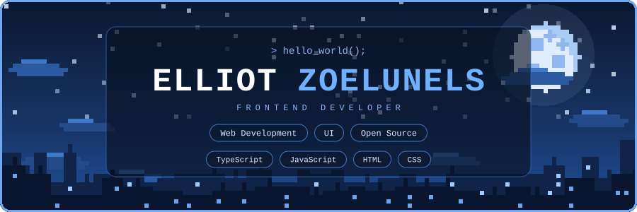
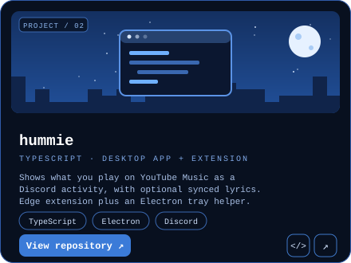

 

---

## ✦ About Me

Hi, I'm **Elliot**, a frontend-focused developer building things with **TypeScript, HTML and CSS**.

I like turning ideas into small working projects, and I'm learning in public, one commit at a time.

---

## 🛠️ Tech Stack

### Languages & Markup

**Programming:** `TypeScript` · `JavaScript`  
**Markup & styling:** `HTML5` · `CSS3`

### Developer Tools

`Git` · `GitHub`

---

## 📂 Featured Projects

<table>
  <tr>
    <td width="50%"></td>
    <td width="50%"></td>
  </tr>
</table>

---

## ✦ Connect

made by Elliot · [@Zoelunels](https://github.com/Zoelunels)
